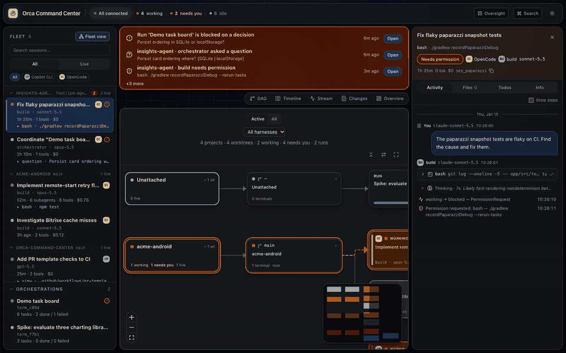
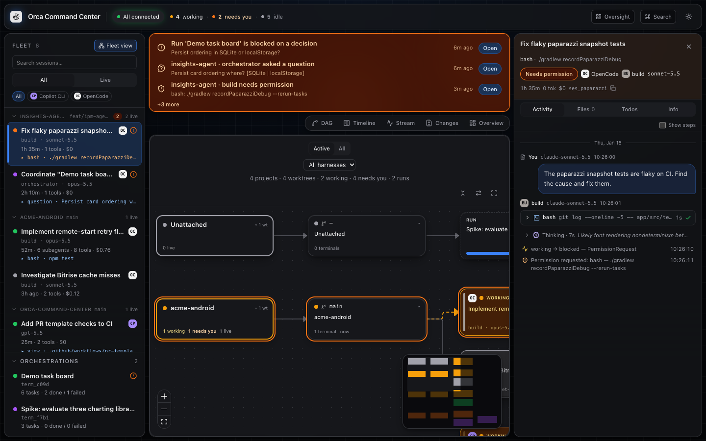
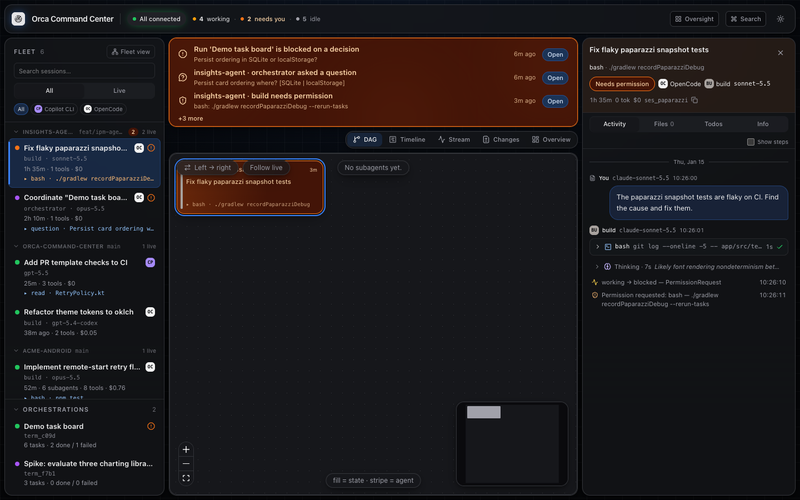
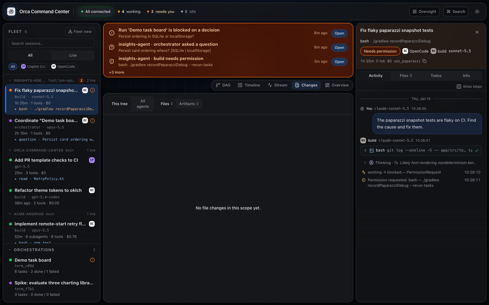
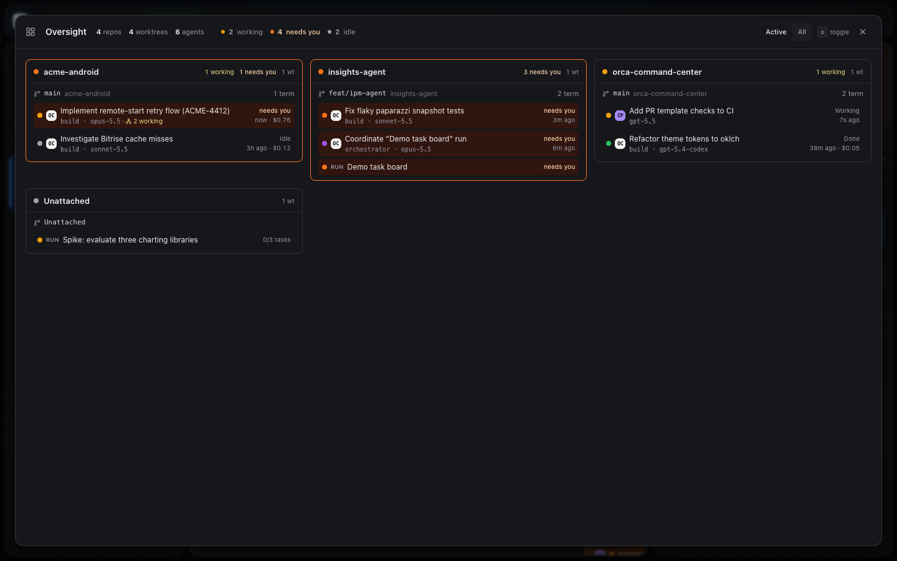
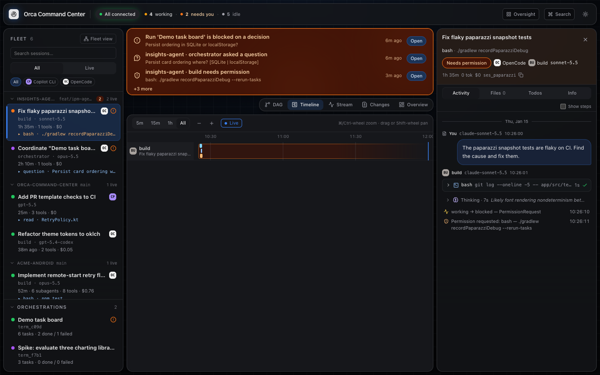
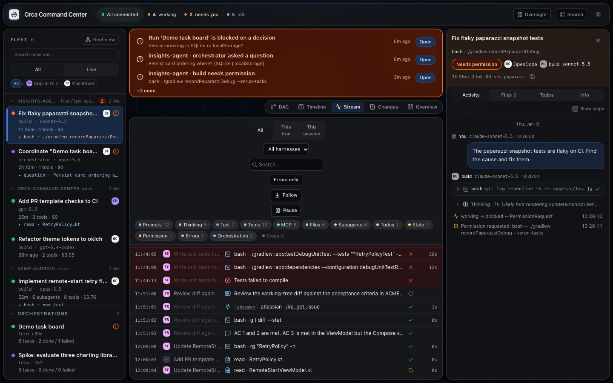
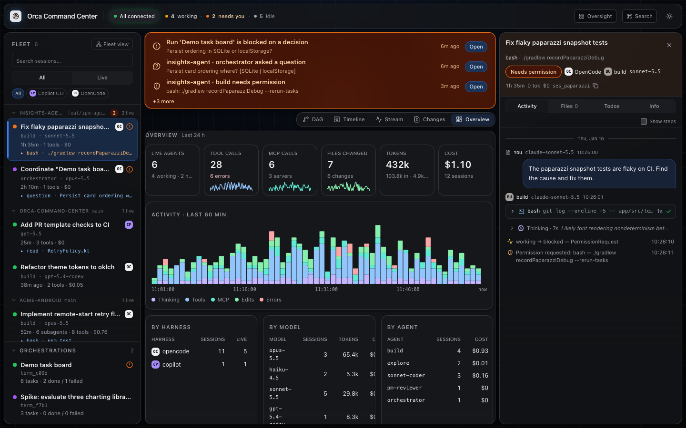
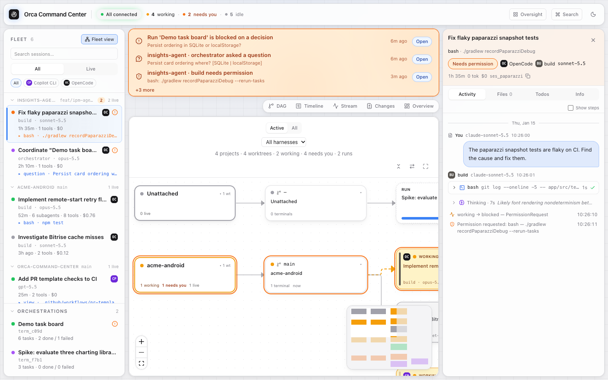

# Orca Command Center

[](https://github.com/geoff-powell/orca-command-center/actions/workflows/ci.yml)

A read-only, local dashboard that shows what your coding agents (OpenCode, Copilot CLI, Claude
Code, Codex, Cursor) and [Orca](https://github.com/stablyai/orca) are doing across worktrees, in
one live view. It tells you, truthfully and live, what every agent is doing, why, and what it
changed. It never writes to agents, databases or Orca.



*Screenshots and the tour are generated from the seeded mock fleet (`?mock=1`).*

| Fleet | DAG |
|---|---|
|  |  |
| **Changes** | **Oversight** |
|  |  |
| **Timeline** | **Stream** |
|  |  |
| **Overview** | **Light theme** |
|  |  |

The experience is a four-beat loop:

1. **Glance.** The header pulse (`3 working · 1 needs you · 30 idle`), the rail's state dots and
   the attention strip say whether anything needs you.
2. **Focus.** Pick a root agent session; the DAG shows its whole subagent tree, live.
3. **Drill.** Click any node; the inspector streams that agent's thinking, tool calls, MCP calls
   and edits as they happen, with full inputs/outputs on demand.
4. **Verify.** The Changes view shows which files each agent touched, with diffs, and what it
   produced (docs, new files, PRs, links).

## Layout

- **Header:** Orca connection pill (with pid), stream pill (`Live` / `reconnecting…`), fleet pulse,
  per-source health chips (click for paths and details), **Oversight** (`o`: a full-screen board of
  every repo → worktree → agent and run, sorted by what needs you; click an agent to open it),
  `⌘K` search, theme toggle.
- **Rail (left):** the fleet grouped by workspace/worktree, with state, harness, agent, model, age,
  tool count and cost; search, Live filter, harness filter; orchestration runs underneath.
- **Center:** an attention strip (only when something needs you) above five switchable views.
- **Dock (right):** the inspector for the selected session or orchestration task
  (Activity / Files / Todos / Info), or the Attention panel plus "Live now" when nothing is selected.

## Quick start

Requires Node ≥ 22.13.

```bash
npm install
npm run build
npm start                 # http://127.0.0.1:4270, opens your browser
```

Development (server with watch + Vite client, fixture-free):

```bash
npm run dev               # Vite on :5173 proxies to the server
# open http://localhost:5173/?mock=1  for the deterministic in-browser mock fleet
```

Checks:

```bash
npm test                  # vitest (server + client)
npm run typecheck
npm run e2e               # Playwright on installed Chrome; real + mock projects (server on :4280)
npm run test:visual       # pixel screenshots of core surfaces on the seeded mock fleet
npm run test:live         # integration against your live local data, incl. Orca + Copilot CLI (screenshots → test-results/live*/)
npm run smoke             # API smoke against :4280   (node scripts/smoke.mjs --port N)
npm run perf              # Plan §11 budgets; starts its own server on :4281
npm run audit             # safety audit against :4280 + source scan
```

The e2e, smoke and audit scripts expect (or, for e2e, start) `node bin/occ.mjs --no-open --port 4280`.
Visual tests need Playwright's Chromium (`npx playwright install chromium`); update baselines with
`npm run test:visual -- --update-snapshots`. CI (`.github/workflows/ci.yml`) runs typecheck, unit
tests, build, the mock e2e and the visual tests. See [AGENTS.md](AGENTS.md) for contributor and
agent guidance.

## Flags

```text
occ [options]

  --port <n>             HTTP port (default 4270; error if in use)
  --host <h>             Bind address (default 127.0.0.1; non-loopback has NO authentication)
  --window-hours <n>     Sessions window, 1-720 (default 24)
  --poll-ms <n>          SQLite change poll, 100-60000 (default 750)
  --orca-poll-ms <n>     Orca CLI poll, 1000-600000 (default 5000)
  --orca-timeout-ms <n>  Orca CLI command timeout, 1000-120000 (default 15000)
  --opencode-db <path>   Explicit opencode.db (error if unreadable)
  --orca-dir <path>      Explicit Orca userData dir (error if unreadable)
  --copilot-dir <path>   Explicit Copilot dir (error if unreadable)
  --claude-dir <path>    Explicit Claude Code config dir, e.g. ~/.claude (error if unreadable)
  --codex-dir <path>     Explicit Codex home, e.g. ~/.codex (error if unreadable)
  --cursor-dir <path>    Explicit Cursor dir, e.g. ~/.cursor (error if unreadable)
  --orca-cli <path>      Explicit orca executable
  --no-opencode          Disable the OpenCode source
  --no-copilot           Disable the Copilot CLI source
  --no-claude            Disable the Claude Code source
  --no-codex             Disable the Codex source
  --no-cursor            Disable the Cursor source
  --no-orca-cli          Disable the Orca CLI source
  --no-orchestration     Disable orchestration.db
  --no-hooks             Disable Orca agent hooks
  --mcp-servers <a,b>    Extra known MCP server names
  --ring-size <n>        Activity ring size, 1000-200000 (default 20000)
  --no-open              Do not open a browser
  --dev                  Dev mode (client served by Vite)
  --verbose              Debug logging
  --version              Print version
  --help                 Print this help
```

## Data sources

Read-only, auto-discovered (override with the flags above):

| Source | What is read |
|---|---|
| OpenCode | `opencode.db`: `session`, `message`, `part`, `event`, `todo`, `project` (indexed queries only; change detection via `PRAGMA data_version` + event tail) |
| Copilot CLI | `~/.copilot/session-state/*` (workspace metadata and `events.jsonl`) |
| Claude Code | `${CLAUDE_CONFIG_DIR:-~/.claude}/projects/*/<session>.jsonl` and `<session>/subagents/*.jsonl` |
| Codex | `${CODEX_HOME:-~/.codex}/sessions/YYYY/MM/DD/rollout-*.jsonl`, `session_index.jsonl` (thread names) |
| Cursor | `~/.cursor/projects/*/agent-transcripts/*.jsonl`, `~/.cursor/chats/*/*/meta.json` |
| Orca hooks | `<orca>/agent-hooks/last-status.json` |
| Orca CLI | `orca status --json`, `orca worktree ps --json`, `orca terminal list --json` (nothing else) |
| Orchestration | `<orca>/orchestration.db` (runs, tasks, dispatches, messages, gates) |

**Never read:** `auth.json`, `mcp-auth.json`, `endpoint.env`, `daemon/*.token`,
`orca-runtime.json`, `orca-e2ee-keypair.json`, `agent-session-authority.key`, `Cookies`,
`~/.copilot/config.json`, `~/.claude/.credentials.json`, `~/.claude.json`, `~/.codex/auth.json`,
Cursor's `store.db` / `state.vscdb` / `mcp.json`, any `*.key` / `*.token` / `*auth*.json`, and the
OpenCode tables `account`, `account_state`, `control_account`, `credential`, `permission`. Details
in [docs/data-sources.md](docs/data-sources.md).

## Safety model

- **Read-only:** SQLite opens with `readOnly: true`; files are only read; the HTTP API accepts
  only `GET`/`HEAD`; the Orca CLI runs only the three allowlisted commands, without a shell.
- **Loopback by default:** binds `127.0.0.1`. Binding elsewhere (`--host`) has **no
  authentication**; do not expose it.
- **Host check, no CORS:** requests whose `Host` is not an allowed loopback name get `403`; no CORS
  headers are sent; a strict CSP and `Cache-Control: no-store` are applied.
- **Redaction:** all transcript-derived strings pass through secret-pattern redaction and ANSI
  stripping; secret-named keys are masked; `data:` URLs are replaced with a placeholder.
- `npm run audit` verifies these claims against a running server and the source tree.

## Views and keyboard shortcuts

Views: **Fleet** (default: one live graph of every project, worktree, session and run; deep links with `s=`/`r=` still open the DAG), **DAG** (subagent tree, or an orchestration run's task graph), **Timeline** (parallelism and
idle gaps), **Stream** (virtualized firehose with filters, follow and pause), **Changes** (files and
diffs, artifacts), **Overview** (tokens, cost, throughput).

| Key | Action |
|---|---|
| `⌘K` / `Ctrl+K` | Command palette |
| `o` | Oversight: birds-eye board of every repo, worktree and agent |
| `1`–`6` | Fleet · DAG · Timeline · Stream · Changes · Overview |
| `j` / `k` | Next / previous root session |
| `J` / `K` | Next / previous session in the cast |
| `Esc` | Close overlay, then clear task → session → run |
| `/` | Focus rail search |
| `.` | Toggle Live only |
| `f` | Toggle stream follow |
| `Space` | Pause / resume stream (Stream view) |
| `t` | Toggle theme |
| `?` | Shortcuts help |

URL state: `?s=<sessionId>&v=dag|timeline|stream|changes|overview&r=<runId>&t=<taskId>`.

## Troubleshooting

- **"Orca isn't running; showing last-known state."** Start Orca. The console keeps showing
  hook/orchestration data it last saw; the Orca pill turns green when `orca status` succeeds.
- **A source shows `missing` / `error`** (click the source chips in the header for the path and
  reason). Pass an explicit path (`--opencode-db`, `--copilot-dir`, `--claude-dir`, `--codex-dir`,
  `--cursor-dir`, `--orca-dir`, `--orca-cli`) or disable the source (`--no-copilot`, …). One
  failing source never takes the console down.
- **Schema newer than expected.** Orca or OpenCode updated its database. The console degrades
  (affected features are noted in the source detail) rather than guessing; update the console.
- **Port in use.** `occ` exits with an error instead of picking another port; choose one with
  `--port <n>` or stop the other process (`lsof -nP -iTCP:4270 -sTCP:LISTEN`).
- **Blank page after `npm start`.** Run `npm run build` first (the client is served from
  `dist/client`).

## Architecture

One Node process: sources (OpenCode, Copilot, Claude Code, Codex, Cursor, Orca hooks, Orca CLI,
orchestration DB) normalize into shared contract types; the store joins them and derives state,
attention, stats and artifacts, and publishes to a hub that serves a REST API and one
Server-Sent-Events stream (`/api/stream`, coalesced to ≤ 4 frames/s). The React 19 SPA (zustand,
React Flow + ELK, Tailwind) bootstraps from `/api/bootstrap` and applies stream events.

- [Plan.md](Plan.md): product, UX, architecture, derivation rules, API, budgets, testing
- [docs/data-sources.md](docs/data-sources.md): what each source provides and the safety rules
- [docs/design-system.md](docs/design-system.md): visual and interaction design
- [tasks/](tasks/): the implementation task breakdown

## License

MIT, see [LICENSE](LICENSE).
